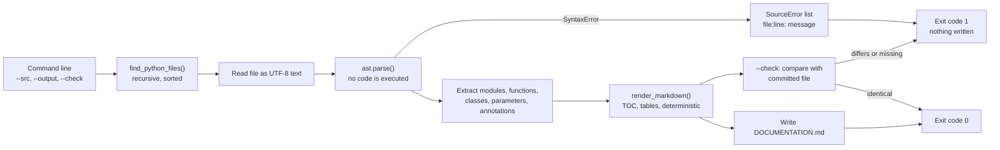
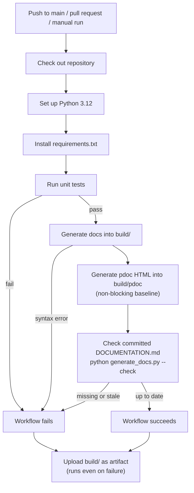

# Automated Documentation Generator for CI/CD Pipelines

A small Python tool that reads Python source code **without running it**, generates a Markdown
reference (`DOCUMENTATION.md`), and a GitHub Actions workflow that tests the tool, regenerates
the documentation and **fails the build when the committed documentation is stale**.

*Subject: Intelligent Developer Tools and AIDevOps Workflows - B.Tech Computer Science.*
*Author: YOUR NAME - Repository: add your GitHub link here after you create it.*

> **Status honesty note:** the unit tests were run locally while building this project. The GitHub
> Actions workflow has **not** been executed yet - it only counts as verified after you push the
> repository and see the run succeed in the Actions tab. The pdoc comparison and the results in
> `docs/evaluation.md` are templates for you to fill with your own measurements.

## Contents

1. [Problem statement](#1-problem-statement) 2. [Motivation and objectives](#2-motivation-and-objectives)
3. [Proposed solution](#3-proposed-solution) 4. [System architecture](#4-system-architecture)
5. [CI/CD flowchart](#5-cicd-flowchart) 6. [Features](#6-features) 7. [Technology stack](#7-technology-stack)
8. [Installation on macOS](#8-installation-on-macos) 9. [Running the generator](#9-running-the-generator)
10. [Running the tests](#10-running-the-tests) 11. [pdoc comparison](#11-pdoc-comparison)
12. [GitHub Actions setup](#12-github-actions-setup) 13. [Example input and output](#13-example-input-and-output)
14. [Limitations](#14-limitations) 15. [Future improvements](#15-future-improvements)
16. [Project structure](#16-project-structure) 17. [Other documents](#17-other-documents)

## 1. Problem statement

Project documentation is written once and then drifts away from the code. Developers forget to
update it, reviewers cannot easily see whether it is current, and nothing in the delivery
pipeline notices. Existing generators produce good output but are not wired into a pipeline
that *enforces* freshness, and many of them need to import (and therefore execute) the code.

## 2. Motivation and objectives

Following the project proposal, the objectives are to:

1. **Research and compare** an existing documentation generator (pdoc) - see [`docs/comparison.md`](docs/comparison.md).
2. **Implement** a custom documentation generator - `generate_docs.py`.
3. **Integrate** generation and validation into a CI/CD pipeline - `.github/workflows/documentation.yml`.
4. **Test and evaluate** the implementation - `tests/` and [`docs/evaluation.md`](docs/evaluation.md).

## 3. Proposed solution

`generate_docs.py` parses every `.py` file under a source directory with Python's `ast` module
and writes one deterministic Markdown file. The same script has a read-only `--check` mode.
The GitHub Actions workflow runs the tests, generates the documentation, and calls `--check`
so that a pull request with out-of-date documentation cannot pass.

## 4. System architecture



Everything lives in one importable module, `generate_docs.py`, with these layers: **data classes**
(`ModuleInfo`, `ClassInfo`, `FunctionInfo`, `Param`), **extraction** (`parse_source`, `collect_modules`),
**rendering** (`render_markdown`) and the **CLI** (`main`).

## 5. CI/CD flowchart



## 6. Features

- Scans a configurable source directory recursively (`--src`), skipping `__pycache__`, hidden and virtual-environment folders.
- Extracts module, class, function and method **docstrings**.
- Detects functions, **async functions**, classes, methods (including `@staticmethod`, `@classmethod`, async methods).
- Extracts parameters (positional-only, keyword-only, `*args`, `**kwargs`), **defaults**, **type annotations** and **return annotations**.
- Generates Markdown with a **table of contents** whose links match GitHub's heading anchors.
- Reports **syntax errors** as `path:line: SyntaxError: ...` for *all* broken files, then exits with code 1 without writing output.
- Handles a **missing source directory** (exit 2) and an **empty project** (exit 0, explanatory note).
- **Never imports or executes** the analysed code (covered by a test).
- **Deterministic** output (no timestamps, sorted modules, LF line endings) so unchanged code gives identical bytes.
- `--check` mode for CI freshness validation; `--include-private`, `--title`, `--output` options.

## 7. Technology stack

Python 3.11 or 3.12 (`ast`, `pathlib`, `argparse`, `dataclasses`, `difflib`) - `unittest` - Markdown - Git and GitHub - GitHub Actions - pdoc (comparison only).
The generator has **no third-party dependencies**; no Docker, paid service or AI API is involved.

## 8. Installation on macOS

Open **Terminal** (Cmd+Space, type "Terminal").

```bash
# 1. Command-line tools (gives you git). Skip if `git --version` already works.
xcode-select --install

# 2. Python 3.12 - install Homebrew first if `brew --version` fails: https://brew.sh
brew install python@3.12
python3.12 --version                     # should print Python 3.12.x

# 3. Get the project (after you have uploaded it - see section 12) or open the folder you downloaded
cd path/to/automated-documentation-generator

# 4. Virtual environment and dependencies
python3.12 -m venv .venv
source .venv/bin/activate                # prompt now starts with (.venv)
python -m pip install --upgrade pip
python -m pip install -r requirements.txt
```

Inside the activated environment `python` is Python 3.12. Re-run `source .venv/bin/activate`
every time you open a new Terminal window. The generator and the tests also work with
Python 3.11 and with Apple's default `python3`, but see the note in section 14 about version differences.

## 9. Running the generator

```bash
python generate_docs.py                                   # src/  ->  DOCUMENTATION.md
python generate_docs.py --src src --output DOCUMENTATION.md
python generate_docs.py --src src --output build/DOCUMENTATION.md --title "My Project"
python generate_docs.py --include-private                 # also document _private names
python generate_docs.py --check                           # verify committed docs are fresh (writes nothing)
python generate_docs.py --help
```

| Exit code | Meaning |
| --- | --- |
| 0 | Success (or documentation is up to date in `--check` mode) |
| 1 | A source file has a syntax/encoding error, or documentation is stale/missing in `--check` mode |
| 2 | Usage error, e.g. the source directory does not exist |

Try the error handling: `python generate_docs.py --src examples/broken`
(prints `examples/broken/bad_syntax.py:11: SyntaxError: '(' was never closed`).

### How generated documentation is committed and updated

`DOCUMENTATION.md` is a **committed, generated file**. The workflow is:

1. Change code in `src/`.
2. Run `python generate_docs.py` (use Python 3.12, the same version as CI).
3. `git add -A && git commit -m "Update code and documentation" && git push`.

If you forget step 2, the CI step *Check committed documentation is up to date* fails, prints a
diff and tells you the command to run. A fresh copy is always available in the workflow's
`generated-documentation` artifact. A fresh checkout is never missing the file because it is committed.

## 10. Running the tests

```bash
python -m unittest                # one command, from the repository root
python -m unittest -v             # verbose: one line per test
```

Expected result: `Ran 31 tests ... OK`. The full list of tests and expected outcomes is in
[`docs/evaluation.md`](docs/evaluation.md#part-1---unit-test-inventory-python--m-unittest).

## 11. pdoc comparison

```bash
python generate_docs.py --src src --output build/DOCUMENTATION.md
PYTHONPATH=src python -m pdoc --output-directory build/pdoc example_package
open build/DOCUMENTATION.md build/pdoc/index.html
python scripts/benchmark.py --runs 10        # prints timings measured on your machine
```

Full explanation, differences, advantages and limitations: [`docs/comparison.md`](docs/comparison.md).
Record your observations in [`docs/evaluation.md`](docs/evaluation.md) (parts E6 and E7).

## 12. GitHub Actions setup

1. On github.com click **New repository**, choose a name, leave it **empty** (no README, no .gitignore, no licence), create it.
2. Edit `LICENSE` and replace `YOUR NAME HERE` with your name.
3. In Terminal, inside the project folder:

```bash
git init -b main
git add .
git commit -m "Initial commit: documentation generator and CI workflow"
git remote add origin https://github.com/<your-username>/<your-repo>.git
git push -u origin main
```

GitHub no longer accepts account passwords for `git push`. The easiest login is the GitHub CLI:
`brew install gh && gh auth login` (choose HTTPS and follow the browser prompts), then push again.

4. Open the repository -> **Actions** tab. The workflow **Documentation CI** starts automatically on push. You can also start it with **Run workflow** (it has `workflow_dispatch`).
5. Open the run and inspect every step. The run is only "passing" if you see a green check there.
6. Scroll to **Artifacts** at the bottom of the run page and download `generated-documentation`.
7. Practise the failure scenarios in `docs/evaluation.md` (E4) on a branch or pull request.

**If the freshness step fails on your first run** even though the doc matches on your Mac, your local
Python minor version probably differs from CI's 3.12 (`ast.unparse` can format a few constructs differently).
Download the artifact (`build/DOCUMENTATION.md`), copy it over `DOCUMENTATION.md`, commit and push - or generate with Python 3.12.

Optional status badge (replace the placeholders after your repo exists):
``

## 13. Example input and output

**Input** (`src/example_package/calculator.py`):

```python
def mean(*values: float, default: float | None = None) -> float | None:
    """Return the arithmetic mean, or ``default`` when no values are given."""
    if not values:
        return default
    return sum(values) / len(values)
```

**Output** (from `DOCUMENTATION.md`):

````markdown
### Function `example_package.calculator.mean`

```python
def mean(*values: float, default: float | None = None) -> float | None
```

> Return the arithmetic mean, or ``default`` when no values are given.

| Parameter | Type | Default |
| --- | --- | --- |
| `*values` | `float` | - |
| `default` | `float \| None` | `None` |

**Returns:** `float | None`
````

See the complete generated file in [`DOCUMENTATION.md`](DOCUMENTATION.md).

## 14. Limitations

These are facts about the current implementation:

- Only top-level functions/classes and direct methods are documented: **no nested classes, no inheritance, no module-level variables**.
- Docstrings are shown as-is; Google/NumPy/reStructuredText sections are not parsed.
- No cross-reference links, search or HTML output.
- Decorators are listed, but properties/overloads are not given special treatment (a property getter and setter appear as two entries).
- `ast.unparse` output can differ slightly between Python versions, so CI is pinned to Python 3.12 and the committed file should be generated with 3.12.
- Files must be UTF-8 encoded; others are reported as errors.
- The pdoc comparison and evaluation numbers are produced by you; none are included here.

## 15. Future improvements

*Not implemented - ideas only:* parse Google/NumPy docstring sections; document nested classes, inheritance and module variables;
a config file (`pyproject.toml`) for options; a pre-commit hook that regenerates docs; a CI job that commits regenerated docs automatically;
a Python version matrix; HTML or MkDocs output; coverage reporting for docstrings.

## 16. Project structure

```
automated-documentation-generator/
├── .github/workflows/documentation.yml   CI workflow
├── src/example_package/                  sample project that gets documented (nested sub-package included)
├── examples/broken/bad_syntax.py         intentionally invalid file for the error-handling demo
├── tests/test_generator.py               31 unittest tests
├── scripts/benchmark.py                  timing script (custom generator vs pdoc)
├── docs/                                 comparison, evaluation template, plan, demo script, viva questions
├── generate_docs.py                      the documentation generator (standard library only)
├── DOCUMENTATION.md                      generated output (committed)
├── requirements.txt   .gitignore   LICENSE   README.md
```

## 17. Other documents

- [`docs/comparison.md`](docs/comparison.md) - custom generator vs. pdoc
- [`docs/evaluation.md`](docs/evaluation.md) - test inventory, evaluation plan, **results template**
- [`docs/week_plan.md`](docs/week_plan.md) - one-week plan
- [`docs/demo_script.md`](docs/demo_script.md) - demonstration script for your teacher
- [`docs/viva_questions.md`](docs/viva_questions.md) - ten viva questions with answers
